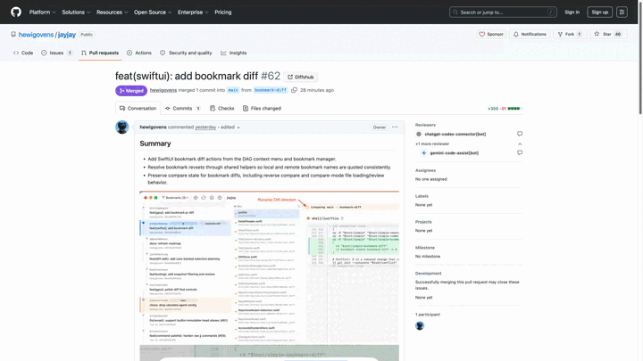

# Open in Diff Viewer

A small Chrome / Edge extension (MV3) that opens a GitHub pull request, comparison, or commit in [JayJay Diff](https://diff.hewig.dev). On a pull request it adds a button next to the title; on PR, compare, and commit pages there's also a right-click menu item and a toolbar-icon shortcut. Everything just swaps `github.com` for the viewer's host on the same path.

JayJay Diff is the default viewer; [Diffshub](https://diffshub.com) is the alternative. The options page opens on install, and later from the toolbar icon's right-click menu → **Options**.

[](https://chromewebstore.google.com/detail/open-in-diffshub/pgmcdokikomeilbkobgfmlihmilingpl)
[](https://github.com/hewigovens/open-in-diffs/actions/workflows/ci.yml)

> **Not affiliated with diffshub.com.** The Diffshub option simply links to diffshub.com; this extension is not made, endorsed, or maintained by Diffshub.

## Demo



_Higher-quality recording: [docs/demo.webm](docs/demo.webm)._

## Features

- **PR button** — a link next to the PR title on every PR sub-page (Conversation, Files changed, Checks, Commits) that opens the pull request in the chosen viewer; Cmd/Ctrl- or middle-click and **Copy Link** work as on any link.
- **Right-click menu** — "Open in <viewer>" on PR, compare (`a...b`, `a..b`, and fork `a...user:b`, including `?expand=1` pre-PR views), and commit pages.
- **Toolbar icon** — opens the current PR, comparison, or commit; on any other tab its tooltip says it opens the viewer's home page instead.
- **Private repositories** — JayJay Diff opens public repositories only, so on a private one the button, menu item, and toolbar icon are disabled and say so. Diffshub can open them with a GitHub token saved on diffshub.com.
- **Options** — choose JayJay Diff or Diffshub; with browser sync on, the choice follows you.
- github.com only (not GitHub Enterprise). Works without a GitHub sign-in for public repositories.

## How it works

- On a PR page the content script places the link beside, not inside, the title `<h1>` (identified by the `#<number>` in the URL), so it stays stable across GitHub's classic and new UIs and stays out of the heading's accessible name.
- Compare and commit pages have no equally stable, visible anchor (the "Comparing changes" heading is hidden on `?expand=1`), so they're covered by the right-click menu and toolbar icon instead — both handled by a tiny background service worker that does the same hostname swap. It sets the toolbar tooltip per tab and shows the menu item only on pages it can open.
- Repository visibility comes from GitHub's `octolytics-dimension-repository_public` meta tag, checked against `octolytics-dimension-repository_nwo` so a tag left over from in-page navigation is ignored.
- The viewer list lives in `src/targets.js`, shared by the content script, the worker, and the options page.
- Vanilla JS — no bundler, no build step, no runtime dependencies.

## Privacy

- **Permissions:** `activeTab`, `contextMenus`, and `storage`, plus host access to `https://github.com/*`, which Chrome shows as "Read and change your data on github.com". The extension needs it on every github.com page, not only PR pages, because GitHub navigates between pages without reloading them.
- **What it reads:** on github.com only, the tab's URL, the PR title heading (to place the button), and GitHub's repository-visibility meta tags. Nothing is read from other sites.
- **What it sends:** nothing on its own. When you click the button, menu item, or toolbar icon, a new tab opens the chosen viewer at the same path (owner, repository, and PR number, compare range, or commit), so that path reaches the viewer's site, which then loads the diff from GitHub under its own privacy terms.
- **What it stores:** your viewer choice, in the browser's synced extension storage, and, while a tab is open, whether that tab's repository is private, in session storage. Nothing is collected or sent to the extension's author.

## Install

[**Install from the Chrome Web Store**](https://chromewebstore.google.com/detail/open-in-diffshub/pgmcdokikomeilbkobgfmlihmilingpl) — works in both Chrome and Edge.

### Unpacked (for development)

1. Open `chrome://extensions` (or `edge://extensions`).
2. Toggle **Developer mode** on.
3. Click **Load unpacked** and select this repo's `src/` folder.

## Develop

For local development you don't need a build — just **Load unpacked** from `src/` (above). `npm test` runs the URL-routing tests with Node's built-in runner.

To produce the signed `.crx` the store accepts, you need `jq`, ImageMagick (`magick` or `convert`), a Chromium-based browser, and an RSA signing key:

```sh
npm run gen-icons              # rasterize src/icons/icon.svg → 16/48/128 PNGs
npm run pack -- path/key.pem   # sign src/ → dist/open-in-diffs-<version>.crx
npm run clean                  # rm -rf dist
```

`src/manifest.json` is the single source of truth for the version.

## Releasing

Releases are automated: bump `version` in `src/manifest.json` (and `package.json`) and push to `main`. If `v<version>` isn't tagged yet, the [release workflow](.github/workflows/release.yml) signs a `.crx`, creates the tag, and attaches the `.crx` to a new GitHub Release. Don't push the tag yourself; to retry a failed release, run the workflow manually from the Actions tab.

The package is signed with a private key held only in the `CWS_SIGNING_KEY` secret ([Verified CRX Uploads](https://developer.chrome.com/blog/verified-uploads-cws)), kept in the protected `chrome-web-store` environment.

Publishing to the store itself is manual.

## Layout

```
src/                              # the extension (Load Unpacked points here)
├── manifest.json                 # MV3, single source of truth for the version
├── targets.js                    # viewer list + stored choice, shared by everything below
├── content.js, content.css       # injects the viewer link into PR pages
├── background.js                 # toolbar-icon + right-click menu handler (PR, compare & commit)
├── options.html, options.js      # viewer picker
└── icons/
    ├── icon.svg                  # brand mark, committed
    └── icon{16,48,128}.png       # gitignored, generated from icon.svg
scripts/
├── gen-icons.sh                  # rasterize the SVG into PNGs (ImageMagick)
├── pack-crx.sh                   # sign src/ into a .crx (Chromium)
└── publish-cws.sh                # upload + publish to the Chrome Web Store
.github/workflows/                # ci.yml (build) and release.yml (sign + publish)
test/                             # node --test (npm test)
docs/                             # demo.gif, demo.webm, store screenshot
```
